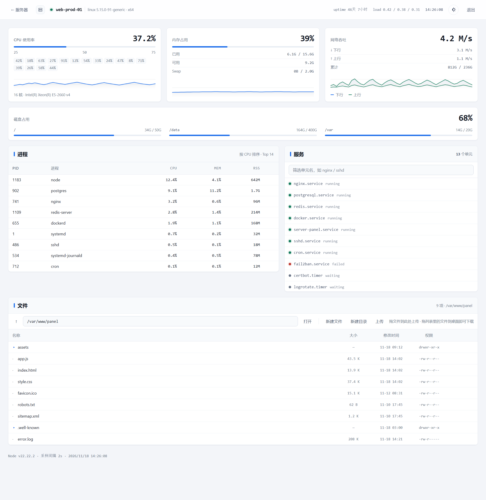

# Server Panel · 服务器监控与控制台

单机自托管的服务器管理面板：指标、进程、服务、日志、文件在一个页面里搞定。
后端一个 Node 进程（只依赖 `ws`、`ssh2`），前端原生 HTML/CSS/JS，**无构建、无前端依赖**。可用 SSH 把多台机器接进来，同一套界面管理。

> **V1.0.0** · MIT · Node 18+ · Linux（systemd）
>
> ⚠️ 面板等价于 shell 权限：能停任意服务、改任意配置。**必须**放在内网或 HTTPS 后面。



<details>
<summary>更多截图（登录 / 服务器列表 / 夜晚主题）</summary>

> 截图为虚构数据（`web-prod-01` / `10.0.0.21` / `/var/www/panel`），不含真实环境信息。


</details>

## 功能

| 模块 | 说明 |
|---|---|
| 概览 | CPU / 每核占用 / 内存 / Swap / 网络双线速率 / 磁盘多挂载点，2s 刷新 |
| 进程 | 按 CPU Top 14，一键结束（先比对 `/proc/<pid>/comm`，防 PID 复用误杀） |
| 服务 | systemd 单元列表 + 筛选，启停/重启/reload/enable，看单元日志 |
| 日志 | `journalctl` 最近 300 行，全屏查看 |
| 文件 | 浏览（默认根目录）/ 新建 / 重命名 / 删除 / 上传下载 / 在线编辑（`Ctrl+S` 保存） |
| 多机 | SSH 添加远程主机（密码或私钥），**保存前先试连，连不上不落库** |
| 界面 | 明暗双主题、键盘可达、断线自动重连 |

## 快速部署

要求：root、Node ≥ 18（脚本只检查不擅自装包）。三种入口，效果一致。

```bash
# ① 什么都没有，直接拉最新 main
curl -fsSL https://raw.githubusercontent.com/Oppenhello/server-panel/main/deploy/install.sh \
  | sudo bash -s -- --port 3100

# ② 已 clone
git clone https://github.com/Oppenhello/server-panel.git && cd server-panel
sudo ./deploy/install.sh

# ③ 上传发行包（内网/离线）
tar -xzf server-panel-1.0.0.tar.gz && cd server-panel-1.0.0
sudo ./deploy/install.sh --server-name panel.example.com
```

脚本做这些事：装到 `/opt/server-panel` + `npm ci` → 静态到 `/var/www/panel` → 生成 `/etc/server-panel.env`（600，随机口令只打印一次）→ systemd 开机自启 → nginx 站点（`/api/`、`/ws` 反代，RHEL 系自动放开 SELinux）→ `curl /api/ping` 自检。
**再跑一次就是升级**（口令不变），`--uninstall` 卸载。

<details>
<summary>全部参数</summary>

| 参数 | 默认 | 说明 |
|---|---|---|
| `--port N` | `3100` | 后端端口（nginx 反代到它） |
| `--user NAME` | `admin` | 登录用户名 |
| `--pass PASS` | 随机 20 位 | 登录口令 |
| `--server-name NAME` | `_` | nginx `server_name` |
| `--no-nginx` | 关 | 不装 nginx，Node 直接托管（绑 `0.0.0.0`，仅内网/试跑） |
| `--dir` / `--web` | `/opt/server-panel` / `/var/www/panel` | 程序 / 静态目录 |
| `--uninstall` | — | 卸载，保留远程主机清单 |

</details>

不想用脚本就四步：

1. `server/` 拷到 `/opt/server-panel`，`npm ci --omit=dev`
2. `web/` 拷到 `/var/www/panel`
3. 照 `deploy/server-panel.env.example` 写 `/etc/server-panel.env`（`PANEL_PASS` 必填，`chmod 600`）
4. 装 `deploy/server-panel.service` 与 `deploy/nginx-panel.conf`，`systemctl enable --now server-panel`

## 配置

全部环境变量，生产放 `/etc/server-panel.env`（`chmod 600`）。

| 变量 | 默认 | 说明 |
|---|---|---|
| `PANEL_PASS` | — | **必填**，缺失时进程直接退出 |
| `PANEL_USER` | `admin` | 登录用户名 |
| `PANEL_PORT` / `PANEL_HOST` | `3100` / `127.0.0.1` | 监听端口 / 地址（别随便改 `0.0.0.0`） |
| `PANEL_WEB` | `../web` | 静态文件目录 |
| `PANEL_WATCH` | `nginx.service,sshd.service,server-panel.service` | 首页固定展示的单元，逗号分隔 |
| `PANEL_PUBLIC_IP` | 自动探测 | 本机卡片上展示的地址 |
| `PANEL_HOSTS` | `/etc/server-panel-hosts.json` | 远程主机清单（600） |

## 安全模型

**有**

- 单口令 + `sp_sess` Cookie（HttpOnly、SameSite=Lax、12h），失败 6 次锁 IP 5 分钟
- 服务操作走单元名白名单 + 固定动作枚举，不接受任意 shell 字符串
- 文件操作限绝对路径，拒绝 `/proc` `/sys` `/dev` `/run`；写入走「临时文件 → 保留属主 → rename」
- 远程凭据只存本地（600）且返回时脱敏；面板默认只听 `127.0.0.1`

**没有**：多用户与权限分级（拿到口令即 root 级）、2FA、审计日志、CSRF token（靠 SameSite 缓解）。命令执行与关机功能已主动移除。

## 接口

除 `/api/ping`、`/api/login` 外均需 Cookie。失败返回 `{ok:false, err}`（`/api/hosts/*` 用 `error`）。

<details>
<summary>完整接口表</summary>

| 方法 | 路径 | 说明 |
|---|---|---|
| GET | `/api/ping` | 存活探测 `{ok, auth, host}` |
| POST | `/api/login` `/api/logout` | `{user, pass}`，成功下发 Cookie |
| GET | `/api/state?host=<id>` | 状态快照（cpu/mem/net/disk/procs/services/host） |
| GET | `/api/hosts` | 主机列表，失败项带 `ok:false` 与原因 |
| POST | `/api/hosts/add` | `{name, host, port, user, authType, password/keyPath}`，先试连再落库 |
| POST | `/api/hosts/delete` | `{id}`，`local` 不可删 |
| POST | `/api/service` | `{unit, action, host?}`，action ∈ start/stop/restart/reload/enable/disable/mask/unmask |
| POST | `/api/logs` | `{unit, lines}`，lines 取 10~500 |
| POST | `/api/proc/kill` | `{pid, name}`，名字不符则拒绝 |
| GET | `/api/fs/list` | `?dir=&host=` |
| GET | `/api/fs/read` `/download` | `?path=&host=`，读 ≤2MB |
| POST | `/api/fs/write` | `{path, content, mtime}`，mtime 冲突返回 409 |
| POST | `/api/fs/mkdir` `/create` `/rename` `/delete` | 目录与文件操作 |
| POST | `/api/fs/upload` | `?dir=&name=&host=`，body 流式写入 |
| WS | `/ws` | 2s 推 `{t:'state'}`，30s 心跳 |

限额：读 2MB / 写 8MB / 上传 64MB（本机）或 32MB（远端）；写入前备份到 `/var/backups/server-panel/<时间戳>/`。

</details>

## 常见问题

| 现象 | 处理 |
|---|---|
| 登录没反应 | `journalctl -u server-panel -n 50`；`PANEL_PASS` 没设时进程会直接退出 |
| 添加服务器提示缺少 ssh2 | 依赖没装全：`cd /opt/server-panel && npm ci --omit=dev` |
| 添加服务器提示端口拒绝 / 认证失败 | 先 `ssh -p <port> <user>@<host>` 验证；私钥要填**目标机**上的绝对路径 |
| 服务列表全 inactive / 进程为空 | 非 systemd 环境或缺 `procps`，属环境问题 |
| 远端「文件管理不可用」 | 目标机没开 `sftp-server` 或被 chroot |
| 装完浏览器 502 | SELinux 拦了反代：`setsebool -P httpd_can_network_connect 1` |
| 重启后要重新登录 | 单实例，会话在内存里，预期行为 |

## 已知限制

- **只在 CentOS 8 / Rocky 与 Windows（开发模式）验证过**；Windows 下只能浏览盘根、进程/服务/速率为空（依赖 `/proc`、`systemctl`、`ps`），生产请用 Linux。
- 远程机指标较粗（无每核明细与温度）；远程文件依赖 SFTP。
- 无虚拟滚动：服务列表上千条、进程数破百需要窗口化。
- 切换主机时编辑器不清空，已打开的文件仍可保存到当前主机——切机器前先关掉。
- 单实例，状态在内存。

## 开发

```bash
node tools/check-refs.js   # 静态一致性（id 引用、CSS 守卫）
node tools/check-ui.js     # 前端行为（真跑 app.js，11 项）
node tools/css-metrics.js  # 设计规范收敛度
```

改前端先跑前两个，不需要服务器。目录：`server/`（后端）、`web/`（前端）、`deploy/`（systemd/nginx/install.sh）、`docs/`（设计系统与截图）、`tools/`（自检）。

## Roadmap

审计日志 · 只读账号 · 服务列表虚拟滚动 · 容器视图 · 切主机自动关编辑器

## License

[MIT](LICENSE)
