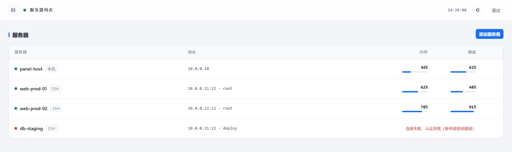
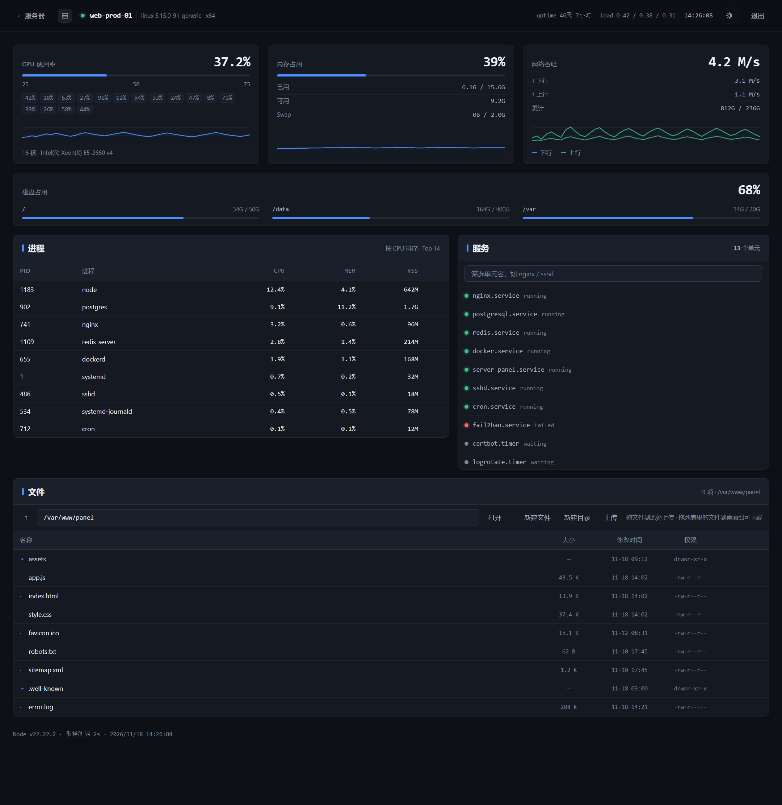

# Server Panel · 服务器监控与控制台

一个**单机自托管**的服务器管理面板：看指标、管服务、翻日志、改配置文件，全部在一个页面里完成。

后端是一个 Node 进程（只依赖 `ws` 与 `ssh2`），前端是原生 HTML/CSS/JS，**没有构建步骤、没有前端依赖**。除了本机，还可以用 SSH 把其他机器接进来，用同一套界面管理。

> **V1.0.0** · MIT · Node 18+
>
> ⚠️ 这个面板等价于 shell 权限：能改任意配置文件、能停任意服务。**必须**挂在 HTTPS 或内网后面，详见 [安全模型](#安全模型)。

```
┌─────────────────────────────┐        ┌──────────────────────────────┐
│  浏览器（原生 JS，无框架）   │        │  server-panel.service        │
│  · 指标卡 / 进程 / 服务      │◄──────►│  Node 18+，只听 127.0.0.1    │
│  · 文件管理 / 在线编辑       │  HTTP  │  · /api/*  指标与操作         │
│  · 日志全屏 / 双主题         │  + WS  │  · /ws     状态推送           │
└─────────────────────────────┘        └───────────┬──────────────────┘
             ▲                                     │ /proc · systemctl
             │ nginx 反代 /api/ 与 /ws              │ journalctl · ps · df
             │                                     ▼
      ┌──────┴───────┐                     ┌──────────────┐
      │   nginx :80  │                     │  本机 Linux   │
      └──────────────┘                     └──────────────┘
                                                   │ SSH（ssh2）
                                                   ▼
                                          ┌──────────────────┐
                                          │ 其他 Linux 服务器 │
                                          └──────────────────┘
```

---

## 目录

- [功能](#功能)
- [界面预览](#界面预览)
- [界面结构](#界面结构)
- [快速开始](#快速开始)
- [配置](#配置)
- [使用速查](#使用速查)
- [接口](#接口)
- [安全模型](#安全模型)
- [目录结构](#目录结构)
- [自检与回归](#自检与回归)
- [常见问题](#常见问题)
- [已知限制](#已知限制)
- [Roadmap](#roadmap)
- [更新记录](#更新记录)

---

## 功能

| 模块 | 能做什么 |
|---|---|
| **概览** | CPU 使用率与每核占用、内存与 Swap、网络上下行速率（双线曲线）、磁盘各挂载点占用；2 秒刷新 |
| **进程** | 按 CPU 排序的 Top 14，显示 PID / CPU% / 内存% / RSS；一键「结束进程」（先核对进程名，防 PID 复用误杀） |
| **服务** | systemd 单元列表（最多 120 条）+ 即时筛选；启动 / 停止 / 重启 / reload / enable / disable；查看单元日志 |
| **日志** | `journalctl` 取最近 N 行（10~500，前端默认 300），全屏查看 |
| **文件** | 浏览任意目录（进入主机默认在根目录）、新建文件/目录、重命名、删除、上传、下载（拖入上传 / 拖出下载）；文本文件在线编辑并保存 |
| **多机** | 通过 SSH 添加其他服务器（密码或私钥），列表里显示名称/地址/内存/硬盘，点进去就是同一套监控界面 |
| **界面** | 白天/夜晚双主题（跟随系统或手动切）、全键盘可达、断线自动重连提示、触屏可用 |

---

## 界面预览

> 截图使用虚构主机与数据（`web-prod-01` / `10.0.0.21` / `/var/www/panel` 等）演示界面，不含任何真实环境信息。

**登录** —— 目标主机提示 + 单口令入口


**服务器列表** —— 内存/硬盘进度条一眼可见；连不上的主机会直接显示失败原因，不会静默消失



**监控页（白天）** —— 三张指标卡并排 + 磁盘通栏 + 进程/服务双栏 + 文件管理


**监控页（夜晚）** —— 同一套 token，切换主题只改 `html[data-theme]`



---

## 界面结构

```
顶栏   主机名 · 系统 · uptime · load · 时钟 · 主题 · 退出
─────────────────────────────────────────────────────────────
  ┌──────────┐ ┌──────────┐ ┌──────────┐
  │ CPU      │ │ 内存     │ │ 网络     │   ← 三张指标卡并排
  │ 主值+曲线 │ │ 主值+KV  │ │ 双线速率 │
  └──────────┘ └──────────┘ └──────────┘
  ┌───────────────────────────────────────┐
  │ 磁盘占用（通栏，挂载点多则自动分列）    │
  └───────────────────────────────────────┘
  ┌─────────────────────────┐ ┌───────────┐
  │ 进程 Top 14（7fr）      │ │ 服务（5fr）│
  │ PID / 进程 / CPU / MEM  │ │ 筛选+操作 │
  └─────────────────────────┘ └───────────┘
  ┌───────────────────────────────────────┐
  │ 文件：路径栏 · 列表 · 右侧编辑器        │
  └───────────────────────────────────────┘
```

响应式：`≤1180px` 指标卡转 2×2（磁盘与网络配对），进程/服务上下堆叠；`≤640px` 全部单列。

设计取舍、颜色/字号/间距令牌、组件规格都写在 [`docs/UI_DESIGN_SYSTEM.md`](docs/UI_DESIGN_SYSTEM.md)。

---

## 快速开始

**系统要求**：Linux（systemd）+ Node.js 18 及以上；nginx 用于反代静态文件与 `/ws`。

### 1. 本机试跑（不装 nginx 也能跑）

```bash
git clone https://github.com/Oppenhello/server-panel.git
cd server-panel/server
npm install --omit=dev          # 装 ws 与 ssh2

# 最小配置：口令必填，没有它服务会拒绝启动
export PANEL_PASS='dev-password'
export PANEL_PORT=3100
export PANEL_HOST=127.0.0.1
export PANEL_WEB="$PWD/../web"

node server.js
# [panel] listening on 127.0.0.1:3100  user=admin  web=/path/to/web
```

浏览器打开 `http://127.0.0.1:3100/`，用 `admin` / `dev-password` 登录。

> Node 自己会托管静态文件，试跑不需要 nginx。想从别的机器访问，请按下节正式部署，**不要**直接把 3100 暴露到公网。

### 2. 正式部署（systemd + nginx）

```bash
# ① 程序文件
mkdir -p /opt/server-panel
cp server/server.js server/remote.js server/package.json server/package-lock.json /opt/server-panel/
cd /opt/server-panel && npm ci --omit=dev

# ② 静态文件
mkdir -p /var/www/panel
cp web/index.html web/style.css web/app.js /var/www/panel/
chown -R nginx:nginx /var/www/panel

# ③ 配置（口令！）
cp deploy/server-panel.env.example /etc/server-panel.env
sed -i "s/change-me-please/$(head -c 18 /dev/urandom | base64 | tr -d '/+=')/" /etc/server-panel.env
chmod 600 /etc/server-panel.env

# ④ systemd
cp deploy/server-panel.service /etc/systemd/system/
systemctl daemon-reload
systemctl enable --now server-panel
systemctl status server-panel --no-pager

# ⑤ nginx：把 deploy/nginx-panel.conf 里的两段 location 放进站点配置，
#    站点 root 指向 /var/www/panel，然后：
nginx -t && systemctl reload nginx
```

打开 `http://<你的服务器>/` 登录即可。

### 3. 验证

```bash
node tools/check-refs.js                 # 静态一致性（不需要服务器）
node tools/check-ui.js                   # 前端行为（不需要服务器）
curl -s http://127.0.0.1:3100/api/ping   # {"ok":true,"auth":false,...}
```

### 4. 接入第二台机器

服务器列表右上角「添加服务器」，填名称 / 地址 / 端口 / 用户名 / 密码或私钥路径。

保存前会先试连，**连不上不会落库**，失败原因直接显示在弹层里。目标机需要满足：

- `sshd` 可达，账号能登录；
- 用私钥时，填的是**目标机上**的私钥路径（面板以 root 运行，需要能读到该文件）；
- 远端文件管理需要 `sftp-server`（OpenSSH 默认自带）。

---

## 配置

全部走环境变量（生产环境放 `/etc/server-panel.env`，`chmod 600`）。

| 变量 | 默认 | 说明 |
|---|---|---|
| `PANEL_PASS` | — | **必填**。登录口令，缺失时进程直接退出 |
| `PANEL_USER` | `admin` | 登录用户名 |
| `PANEL_PORT` | `3100` | 监听端口 |
| `PANEL_HOST` | `127.0.0.1` | 监听地址。除非有防火墙，别改成 `0.0.0.0` |
| `PANEL_WEB` | `../web` | 静态文件目录（nginx 的 root 也指这里） |
| `PANEL_WATCH` | `nginx.service,sshd.service,server-panel.service` | 首页固定展示的单元，逗号分隔 |
| `PANEL_PUBLIC_IP` | 自动探测 | 本机卡片上展示的地址 |
| `PANEL_HOSTS` | `/etc/server-panel-hosts.json` | 远程主机清单路径（自动创建，600 权限） |

改配置后 `systemctl restart server-panel`。改前端只需替换文件 + `systemctl reload nginx`，不必重启后端。

---

## 使用速查

登录 → 服务器列表 → 选一台进入监控页。

| 操作 | 位置 |
|---|---|
| 添加服务器 | 列表右上角「添加服务器」，保存前会试连 |
| 返回列表 | 监控页顶部「← 服务器」 |
| 结束进程 | 进程行右侧 ⏻ 按钮 → 确认卡片（不用输名字） |
| 管理服务 | 服务行 hover 出现「重启 / 停止 / 启用」；「日志」打开全屏日志 |
| 浏览文件 | 路径栏输入任意绝对路径回车；`↑` 上一级。进入主机时默认在根目录 |
| 编辑文件 | 点文件名 → 右侧编辑器（`Ctrl/⌘ + S` 保存，`Tab` 插入两空格） |
| 放大编辑 | 编辑器右上角 `⤢` → 大卡片，保存后自动同步回内嵌编辑器并关闭 |
| 上传 / 下载 | 拖文件进面板上传；拖文件行出去下载 |
| 切换主题 | 顶栏右侧圆形按钮，或登录页右上角 |
| 关闭弹层 | `Esc`（日志 / 确认 / 大编辑器）；「添加服务器」用右上角 × |

---

## 接口

除 `POST /api/login` 与 `GET /api/ping` 外，全部需要会话 Cookie `sp_sess`（HttpOnly、SameSite=Lax、12 小时）。

失败时返回 `{"ok":false,"err":"原因"}`；`/api/hosts/*` 用的是 `error` 字段。

| 方法 | 路径 | 说明 |
|---|---|---|
| GET | `/api/ping` | 存活探测，返回 `{ok, auth, host}` |
| POST | `/api/login` | `{user, pass}` → `{ok}` + Set-Cookie |
| POST | `/api/logout` | 注销 |
| GET | `/api/state?host=<id>` | 完整状态快照（cpu/mem/net/disk/procs/services/host） |
| GET | `/api/hosts` | 服务器列表（含内存/硬盘摘要，失败项带 `ok:false` 与原因） |
| POST | `/api/hosts/add` | `{name, host, port, user, authType, password 或 keyPath}`，`authType` ∈ `password`/`key`；**先试连再落库** |
| POST | `/api/hosts/delete` | `{id}`，`local` 不可删 |
| POST | `/api/service` | `{unit, action, host?}`，action ∈ start/stop/restart/reload/enable/disable/mask/unmask |
| POST | `/api/logs` | `{unit, lines, host?}`，lines 取 10~500 |
| POST | `/api/proc/kill` | `{pid, name, host?}`，名字不符则拒绝（防 PID 复用） |
| GET | `/api/fs/list` | `?dir=&host=` 列目录（参数名是 `dir`） |
| GET | `/api/fs/read` | `?path=&host=` 读文本（≤2MB，二进制拒绝） |
| GET | `/api/fs/download` | `?path=&host=` 下载（attachment） |
| POST | `/api/fs/write` | `{path, content, mtime}`，mtime 不一致返回 409 冲突 |
| POST | `/api/fs/mkdir` `/create` `/rename` `/delete` | 目录与文件操作 |
| POST | `/api/fs/upload` | `?dir=&name=&host=`，原始 body 流式写入 |
| WS | `/ws` | 服务端 2s 推 `{t:'state'}`；30s 心跳 |

限额：读 2MB、写 8MB、上传 64MB（本机）/ 32MB（SSH 远端）。写入前旧内容备份到 `/var/backups/server-panel/<时间戳>/`。

---

## 安全模型

**做了：**

- 单一口令 + 会话 Cookie（`HttpOnly`、`SameSite=Lax`、12h 过期）；口令用 `crypto.timingSafeEqual` 比较。
- 登录失败 6 次锁定该 IP 5 分钟（返回 429）。
- 服务操作走**白名单**：单元名必须匹配 `^[A-Za-z0-9@._:-]+\.(service|socket|timer|target|mount)$`，动作必须是固定枚举 —— 不接受任意 shell 字符串。
- 文件操作限制绝对路径，拒绝对 `/proc`、`/sys`、`/dev`、`/run` 的访问；写入用「同目录临时文件 → 保留属主 → rename」，避免半截文件。
- 结束进程前比对 `/proc/<pid>/comm` 与前端传来的名字。
- 远程主机密码/私钥只存在服务器本地 `/etc/server-panel-hosts.json`（600），接口返回时脱敏。
- 面板默认只听 `127.0.0.1`，由 nginx 反代。

**没做（也就是你需要注意的）：**

- **没有多用户与权限分级**：拿到口令就是 root 级能力（进程以 root 运行才能 `systemctl`、改 `/etc`）。
- 没有 2FA、没有审计日志（`journalctl -u server-panel` 只能看到访问异常，看不到逐条操作）。
- 没有 CSRF token（靠 `SameSite=Lax` + 同源 JSON 请求缓解）。
- 命令执行与重启/关机功能**已被主动移除**：文件编辑 + 服务控制已覆盖绝大多数运维场景，而一个能执行任意命令的 Web 面板风险过高。

---

## 目录结构

```
server-panel/
├── server/
│   ├── server.js          # HTTP + WS 服务、指标采集、服务控制、本机文件管理
│   ├── remote.js          # 远程主机：SSH 探测 + SFTP 文件管理
│   ├── package.json       # 依赖：ws、ssh2
│   └── package-lock.json  # 锁定版本，配合 npm ci 可复现安装
├── web/
│   ├── index.html         # 单页：登录 / 服务器列表 / 监控页 / 各类弹层
│   ├── style.css          # 设计系统（双主题 token，无框架）
│   └── app.js             # 全部前端逻辑（单 IIFE，无构建）
├── deploy/
│   ├── server-panel.service
│   ├── server-panel.env.example
│   └── nginx-panel.conf   # /api/ 与 /ws 反代片段
├── docs/
│   ├── UI_DESIGN_SYSTEM.md
│   └── screenshots/       # README 用的界面截图（虚构数据）
└── tools/                 # 回归与验收脚本
```

---

## 自检与回归

改完前端**先跑前两个**（不需要服务器、也不需要装依赖）：

```bash
# 静态一致性：id 引用、CSS 守卫（[hidden]、#tip 顺序、两栏滚动区）
node tools/check-refs.js

# 前端行为：最小 DOM 打桩，真跑 web/app.js
# 覆盖 登录 / 渲染 / 筛选 / 文件列表 / 打开 / 保存 / 大卡片 / 断线 / 主题 / 结束进程
node tools/check-ui.js

# 设计系统收敛度（间距 / 字号 / 颜色字面量 / 重复定义）
node tools/css-metrics.js
```

线上接口验收（需要能访问面板）：

```bash
node tools/api-test.js       http://127.0.0.1 admin '<PANEL_PASS>'
node tools/fs-test.js        http://127.0.0.1 admin '<PANEL_PASS>'
node tools/proc-test.js      http://127.0.0.1 admin '<PANEL_PASS>' <PID> <进程名>
node tools/remote-fs-test.js http://127.0.0.1 admin '<PANEL_PASS>'
```

---

## 常见问题

| 现象 | 原因 | 处理 |
|---|---|---|
| 登录页输口令没反应 / 一直转 | 服务没起来，或 `PANEL_PASS` 没设 | `journalctl -u server-panel -n 50`；缺口令时进程会直接退出 |
| 添加服务器提示「服务器缺少 ssh2 依赖」 | 只装了 `ws` | `cd /opt/server-panel && npm install`（或 `npm ci --omit=dev`） |
| 添加服务器提示「连接失败：端口拒绝连接」 | 目标机 sshd 没开 / 端口不对 / 被防火墙拦 | 先在命令行 `ssh -p <port> <user>@<host>` 验证 |
| 添加服务器提示「认证失败」 | 账号密码错，或私钥路径在目标机上不存在 | 私钥要填**目标机**上的绝对路径 |
| 服务列表全是 `inactive` | 非 systemd 环境（容器、Windows 等） | 正常现象，该环境下服务控制不可用 |
| 进程列表为空 | 缺 `ps`（`procps`） | `apt install procps` / `yum install procps-ng` |
| 远端「文件管理不可用」 | 目标机没开 SFTP，或被 chroot | 确认 `sftp-server` 存在且 sshd 未禁用 |
| 编辑文件提示「该目录不允许访问」 | 命中了 `/proc` `/sys` `/dev` `/run` 黑名单 | 设计如此 |
| 上传大文件失败 | 本机上限 64MB、远端 32MB | 大文件走 SFTP / scp |
| Windows 下点文件夹进不去子目录 | 服务端要求路径以 `/` 开头，`D:\xxx` 被判非法 | 仅开发模式受限，见 [已知限制](#已知限制) |
| 重启服务后要重新登录 | 会话存在内存里（单实例） | 预期行为 |

---

## 已知限制

1. **无虚拟滚动**：服务列表上百条、进程 Top 14，当前规模无感；单元数破千需要窗口化。
2. **远程机指标较粗**：只有 CPU / 内存 / 磁盘 / 网络 / 进程 Top 24 / 服务 120 条，没有每核明细与温度。
3. **远程文件操作用 SFTP**：需要远端 `sftp-server`；被 chroot 或禁用 SFTP 的机器会退回「文件管理不可用」。
4. **单实例**：状态在内存里，重启后面板会话清空、`hosts` 清单仍在磁盘。
5. **只在 CentOS 8 / Rocky 与 Windows（开发模式）上验证过**，Debian 系的 `systemctl` 与 `df` 输出一致，理论通用但未逐项回归。
6. **Windows 只是开发模式**：路径校验要求以 `/` 开头（`fsSafe`），所以 Windows 下只能浏览盘根、进不了子目录；进程、服务、网络速率也会是空的（依赖 `/proc`、`ps`、`systemctl`）。生产请用 Linux。
7. **切换主机时编辑器不会清空**：已打开的文件仍留在编辑器里，此时点保存会写到当前主机的同名路径。切机器前请先关闭编辑器。

---

## Roadmap

- [ ] 审计日志（谁在什么时候停了哪个服务、改了哪个文件）
- [ ] 二级权限（只读账号 / 运维账号）
- [ ] 服务列表虚拟滚动 + 进程树视图
- [ ] 远程主机指标补充每核占用与温度
- [ ] 容器（Docker）视图
- [ ] 操作确认卡片里的「影响范围」提示（停这个服务会连带停掉什么）
- [ ] 切换主机时自动关闭编辑器，避免写错机器

---

## 更新记录

**2026-11-18 · 视觉重构与缺陷修复**

- 界面重做：中性冷灰底 + 蓝色强调色（原琥珀强调色与告警色几乎同色，语义冲突）；指标区由「一整块带内部分隔线」改为四张独立卡片，`≤1180px` 排 2×2；字号收敛为 11/12/13/15/20/26 六档，间距收敛为 4/8/12/16/24/32。
- 修复：添加服务器时后端已拒绝却仍提示「已添加」（`api()` 对 4xx 不抛异常，前端未判 `ok`）；移除服务器同一问题。
- 修复：文件面板进入任意主机（含 SSH 远端）统一从根目录开始；远端主机此前不加载文件列表，会停留在上一台机器的路径与内容。
- 修复：未声明 `type` 的输入框退回浏览器默认立体边框，悬停时边框一半深一半浅。
- 依赖：`package.json` 补上 `ssh2`（此前后端代码已在用，README 也已声明，但依赖里漏写），新增 `package-lock.json`。
- 文档：README 增加界面截图（`docs/screenshots/`，均为虚构数据），补充故障排查与更新记录。

**V1.0.0** — 首个公开版本，功能与接口在此定型。

---

## License

[MIT](LICENSE)
